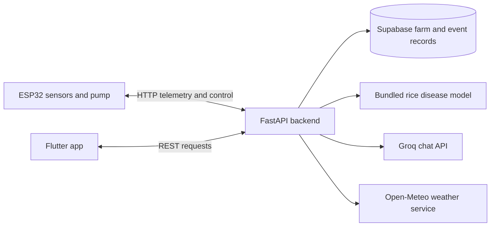

# Smart Agriculture Platform

**A Flutter and FastAPI platform for farm monitoring, irrigation control, rice disease screening, and agricultural assistance.**

## Overview

The platform connects a Flutter mobile client to a FastAPI backend and ESP32 firmware. It collects field telemetry, supports automatic or manual pump control, stores farm and event records in Supabase, classifies rice leaf images with a bundled Keras model, and provides weather and chat endpoints.

## Features

- View farm, sensor, irrigation, and disease information in the Flutter app.
- Receive ESP32 telemetry and expose pump commands in AUTO or MANUAL mode.
- Monitor irrigation events in the backend and store history in Supabase.
- Classify rice leaf images into Brown Spot, Healthy, Leaf Blast, or Sheath Blight.
- Retrieve weather data and answer farming questions through the weather and AI assistant endpoints.
- Connect the assistant to Groq when configured; a fallback response path is also implemented.

## Tech Stack

Flutter and Dart, FastAPI, Python, Keras/TensorFlow, Supabase, Groq, Open-Meteo, ESP32 Arduino firmware, and HTTP/JSON.

## Architecture



## Project Structure

```text
.
├── backend/
│   ├── app/
│   │   ├── api/                 # Farm, device, sensor, irrigation, disease, agent, weather
│   │   ├── services/            # Model, irrigation, IoT, weather, and assistant logic
│   │   └── main.py
│   ├── models/rice_disease_model.keras
│   ├── Arduino/esp32_smart_farming/
│   │   └── esp32_smart_farming.ino
│   ├── .env.example
│   └── requirements.txt
└── frontend/
    ├── lib/
    │   ├── screens/
    │   ├── services/
    │   └── main.dart
    └── pubspec.yaml
```

## Installation and Execution

### Backend

The backend requires Python, a Supabase project, and TensorFlow/Keras for disease inference. From the repository root:

```bash
cd backend
python -m venv .venv
# Activate the environment for your shell, then:
python -m pip install --upgrade pip
python -m pip install -r requirements.txt numpy tensorflow
```

Copy `.env.example` to `.env` in `backend/` and set the Supabase URL/key. The backend also accepts Groq and Blynk settings from that file. Create the Supabase tables expected by the API: `farms`, `irrigation_history`, and `disease_history`; this repository does not include a database migration or SQL schema.

Start the API from the `backend/` directory:

```bash
uvicorn app.main:app --reload
```

FastAPI's interactive API documentation is available at [http://127.0.0.1:8000/docs](http://127.0.0.1:8000/docs).

### Flutter app

Install Flutter with the Dart SDK version required by `frontend/pubspec.yaml`. In another terminal:

```bash
cd frontend
flutter pub get
flutter run
```

Set the backend address in `frontend/lib/services/api_service.dart` to an address reachable from your device. For an Android emulator, use the host machine's emulator-accessible address; for a physical device, use the computer's LAN address.

### ESP32 firmware

Open `backend/Arduino/esp32_smart_farming/esp32_smart_farming.ino` in the Arduino IDE. Set the Wi-Fi credentials and `API_BASE` to the backend computer's LAN address, install the ArduinoJson and DHT libraries, and flash the sketch to an ESP32 wired to the sensors and relay described in the firmware comments.

